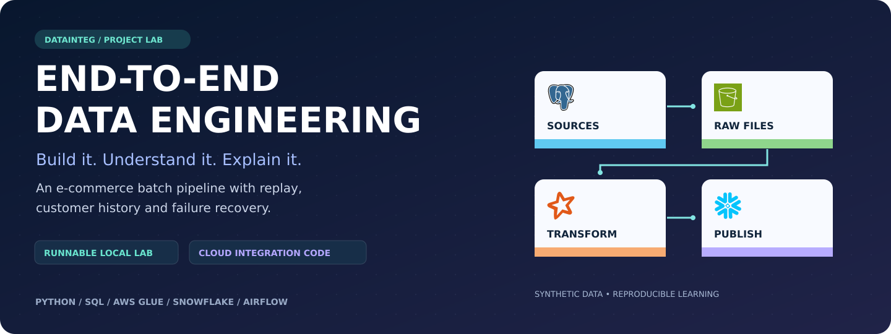
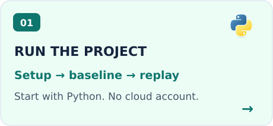
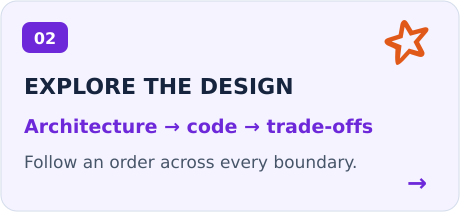
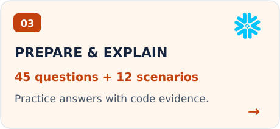
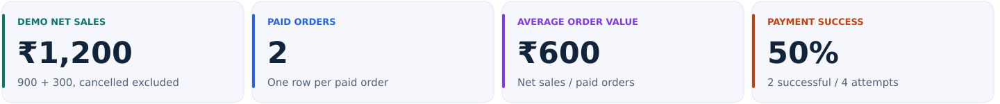
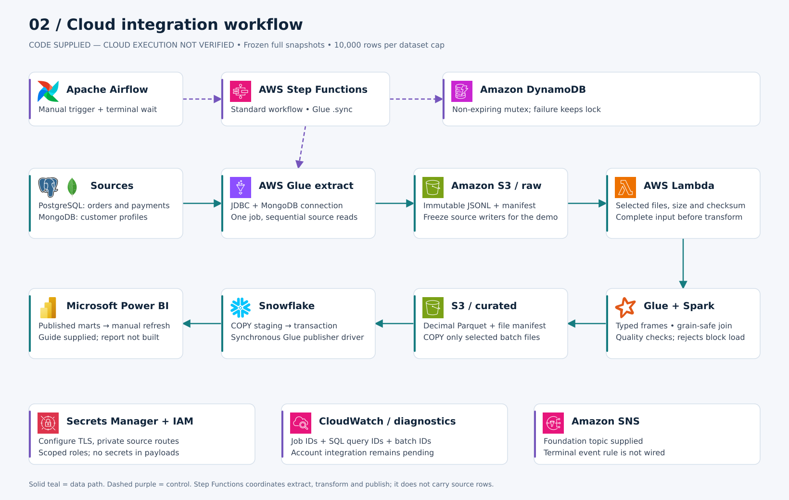

<a id="top"></a>

<p align="center">
  
</p>

<h1 align="center">End-to-End Data Engineering Project</h1>

<p align="center">
  <strong>From source records to trusted metrics — with the code, diagrams and interview practice to explain every step.</strong>
</p>

<p align="center">
  <a href="#quick-start"><strong>🚀 Quick start</strong></a> ·
  <a href="#architecture"><strong>🏗 Architecture</strong></a> ·
  <a href="#code"><strong>💻 Code</strong></a> ·
  <a href="#interview"><strong>🎯 Interview</strong></a> ·
  <a href="#tutorial"><strong>📚 Tutorial</strong></a> ·
  <a href="docs/README.md"><strong>🧭 All docs</strong></a>
</p>

<p align="center">
  <a href="docs/VALIDATION.md">✓ Local reference verified</a> &nbsp; | &nbsp;
  <a href="pyproject.toml">Python 3.11+</a> &nbsp; | &nbsp;
  <a href="docs/INTERVIEW_QUESTIONS.md">45 interview questions</a> &nbsp; | &nbsp;
  <a href="LICENSE">MIT project code</a>
</p>

---

This project follows a synthetic e-commerce order through extraction, file validation, quality checks, customer history and warehouse publication. You can **run the local pipeline**, **study the supplied cloud code**, and **practice explaining the design** from the same repository.

> **What works today:** the Python/SQLite reference and PostgreSQL/MongoDB seeding are verified. AWS/Snowflake integration code is supplied but has not been deployed or verified. Power BI instructions and narration scripts are included; a finished report, recorded audio and video are not. [See the evidence and remaining work →](docs/IMPLEMENTATION_STATUS.md)

<p align="center">
  <a href="docs/GETTING_STARTED.md"></a>
  <a href="docs/ARCHITECTURE.md"></a>
  <a href="docs/INTERVIEW_QUESTIONS.md"></a>
</p>

## The result you will reproduce



Order O100 contributes ₹900. Order O101 contributes ₹300. The cancelled order contributes zero. Four payment attempts stay separate from the sales lines, so a payment retry never doubles revenue. [Understand the calculations →](docs/DATA_CONTRACTS.md#business-calculations-and-fixture)

<a id="quick-start"></a>

## 🚀 Run your first batch

**You need:** Python 3.11+ and Git. The local route has no third-party Python dependencies and does not require Docker or a cloud account.

```bash
git clone https://github.com/datainteg/end-to-end-data-engineering-project.git
cd end-to-end-data-engineering-project

# 1. Publish the fixture, then replay the same batch
python3 -m pipeline.local demo

# 2. Observe a customer moving from Silver to Gold
python3 -m pipeline.local customer-change

# 3. Check correctness and failure recovery
python3 -m unittest discover -s tests -v
```

**Expected first run:** `PUBLISHED`, then `ALREADY_PUBLISHED`. The customer change adds observed history while the four business metrics remain unchanged.

<details>
<summary><strong>See the expected metric output and generated files</strong></summary>

```json
{
  "net_sales": "1200.00",
  "paid_orders": 2,
  "aov": "600.00",
  "payment_success_rate": "0.5000"
}
```

```text
.runtime/
├── raw/batch_id=.../attempt_id=.../   # selected immutable JSONL + manifest
├── audit/                           # quality counts and rejection evidence
└── warehouse.sqlite                 # facts, history, ledger and watermarks
```

Amounts are synthetic INR. Local stored amounts are integer **paise**. Running the demo again is safe; use `--root .runtime/my-lab` with both commands for an independent warehouse. Runtime files are ignored by Git.

</details>

[Full setup & troubleshooting](docs/GETTING_STARTED.md) · [Guided hands-on tutorial](tutorial/WALKTHROUGH.md) · [Executed checks](docs/VALIDATION.md)

<a id="architecture"></a>

## 🏗 Understand the architecture



**Follow the solid data path:** PostgreSQL/MongoDB → Glue extraction → S3 raw → Lambda validation → Spark transformation → curated Parquet → Snowflake publication → Power BI. The supplied cloud workflow uses small, frozen full snapshots. Airflow and Step Functions coordinate execution; the data lives in files and databases.

| 🟢 Working reference | 🔵 Cloud integration | 🟠 Advanced design |
| --- | --- | --- |
| Python + SQLite, reproducible locally | Supplied Glue, S3, Lambda, Snowflake and orchestration code | Proposed incremental extraction, distributed quality and SQL recovery |
| [View local diagram](docs/diagrams/local-reference.svg) | [Read the cloud setup](docs/CLOUD_SETUP.md) | [Explore the roadmap](docs/ARCHITECTURE.md#advanced-upgrade-plan) |

**Edit the diagrams:** [Download the four-page draw.io file](docs/diagrams/ecommerce-architecture.drawio) · [Open the diagram gallery](docs/diagrams/README.md) · [View the warehouse model](docs/diagrams/warehouse-model.svg)

<details>
<summary><strong>Why this design? Five decisions worth understanding</strong></summary>

| Decision | What it protects |
| --- | --- |
| Immutable attempts + explicit manifest | Replay uses selected evidence, not an arbitrary folder scan |
| Order, sales-line and payment-attempt facts | Multiple payment attempts do not multiply sales |
| Observed customer SCD2 | Profile changes preserve previous observations |
| One transaction for facts, ledger and watermarks | Failed publication does not move the committed boundary |
| Serialized publication | A second writer cannot race the first publisher |

The cloud code caps each dataset at 10,000 rows and uses driver-side quality checks. Its mutex does not expire automatically. These are teaching choices with documented limits, not claims of production scale. [Read the trade-offs →](docs/ARCHITECTURE.md)

</details>

<a id="code"></a>

## 💻 Read the code in the right order

Start with the five files below. Each answers a specific question about the pipeline.

| Step | Open the code | What to look for |
| --- | --- | --- |
| **01 · Create the data** | [pipeline/fixture.py](pipeline/fixture.py) | Five datasets and the ₹1,200 baseline |
| **02 · Trust the input** | [pipeline/contracts.py](pipeline/contracts.py) | Required datasets, bounds, file paths and SHA256 |
| **03 · Clean & publish** | [pipeline/local.py](pipeline/local.py) | `clean()`, `publish()`, SCD2 and transaction rollback |
| **04 · Prove behavior** | [tests/test_pipeline.py](tests/test_pipeline.py) | Replay, corruption, invalid corrections and concurrency |
| **05 · Map to the cloud** | [jobs/](jobs/) · [sql/snowflake/](sql/snowflake/) | Actual connector calls, typed Parquet and publication DML |

**The idea behind a sales line:**

```python
from pipeline.local import money

quantity = 2
revenue_paise = quantity * money("500.00") - money("100.00")
assert revenue_paise == 90000  # ₹900.00, stored without floating-point money
```

[Open the annotated code tour →](docs/CODE_TOUR.md)

<details>
<summary><strong>Browse the full repository by responsibility</strong></summary>

| Area | Files | Purpose |
| --- | --- | --- |
| Local reference | [pipeline/](pipeline/) · [tests/](tests/) | Fixture, quality, history and verified publication behavior |
| Source setup | [sources/](sources/) · [local/](local/) · [seed script](scripts/seed_sources.py) | PostgreSQL schema and MongoDB/SQL fixture seed |
| Cloud processing | [jobs/](jobs/) · [lambdas/](lambdas/) | Extract, validate, transform and publish |
| Warehouse | [sql/snowflake/](sql/snowflake/) | Integration, bootstrap, publication and validation SQL |
| Orchestration | [orchestration/](orchestration/) · [infra/](infra/) | Airflow, Step Functions and foundation resources |
| Analytics | [powerbi/](powerbi/) | Report model, DAX and SQL reconciliation |
| Learning | [docs/](docs/) · [tutorial/](tutorial/) | Setup, architecture, interview practice and narration |
| Visuals | [docs/diagrams/](docs/diagrams/) · [docs/media/](docs/media/) | Editable diagrams, logo credits and README artwork |

</details>

<a id="interview"></a>

## 🎯 Explain it in an interview

**45 short answers · 12 failure scenarios · a ten-minute practice plan**

| Start here | Then explain | Finish with evidence |
| --- | --- | --- |
| [Your one-minute project story](docs/INTERVIEW_QUESTIONS.md#explain-the-project-first) | [Grain, quality and calculations](docs/INTERVIEW_QUESTIONS.md#quality-and-business-calculations) | [History, transactions and replay](docs/INTERVIEW_QUESTIONS.md#warehouse-history-and-safe-replay) |
| [Source and extraction choices](docs/INTERVIEW_QUESTIONS.md#sources-storage-and-extraction) | [Orchestration and recovery](docs/INTERVIEW_QUESTIONS.md#orchestration-security-and-operations) | [Scenario questions](docs/INTERVIEW_QUESTIONS.md#scenario-questions-say-the-action-and-the-evidence) |

<details>
<summary><strong>Try one: Why not join payment attempts directly to sales lines?</strong></summary>

O101 has one ₹300 line and two payment attempts. A direct join produces two copies of that line and a wrong ₹600 sales sum. Keep payment attempts in their own fact or aggregate to the required grain before joining. A distinct order count does not repair duplicated revenue.

</details>

<details>
<summary><strong>Try another: What if publication fails after changing a customer version?</strong></summary>

Customer updates, fact changes, the batch ledger and watermarks belong to one database transaction. A failure before commit rolls those changes back. Show `test_rollback_preserves_targets_and_watermarks` in the test suite, and distinguish that tested local behavior from the pending Snowflake integration test.

</details>

[Open the complete interview guide →](docs/INTERVIEW_QUESTIONS.md)

<a id="tutorial"></a>

## 📚 Learn by doing

| Lesson | Your task | Success looks like |
| --- | --- | --- |
| **1 · Run** | [Publish the fixture](tutorial/WALKTHROUGH.md#lesson-1-run-and-reconcile) | ₹1,200 sales; 2 paid orders |
| **2 · Inspect** | [Read facts and control state](tutorial/WALKTHROUGH.md#lesson-2-read-the-warehouse) | You can explain each table's grain |
| **3 · Replay** | [Publish again safely](tutorial/WALKTHROUGH.md#lesson-3-replay-and-observe-history) | Stable totals and preserved customer history |
| **4 · Break it** | [Exercise failure boundaries](tutorial/WALKTHROUGH.md#lesson-4-test-failure-and-recovery) | No partial publication or moved watermark |
| **5 · Extend** | [Plan the cloud proof](tutorial/WALKTHROUGH.md#lesson-5-map-to-the-cloud) | A clear separation of code, evidence and future work |

**Making a video?** [Recording plan](tutorial/RECORDING.md) · [Nine voiceover scripts](tutorial/voiceover/README.md) · [Power BI report guide](powerbi/README.md)

## 🧭 Keep exploring

| Build & run | Design & explain | Operate & contribute |
| --- | --- | --- |
| [Local setup](docs/GETTING_STARTED.md) | [Architecture](docs/ARCHITECTURE.md) | [Recovery and teardown](docs/OPERATIONS.md) |
| [Cloud setup](docs/CLOUD_SETUP.md) | [Data contracts](docs/DATA_CONTRACTS.md) | [Validation evidence](docs/VALIDATION.md) |
| [Code tour](docs/CODE_TOUR.md) | [Interview questions](docs/INTERVIEW_QUESTIONS.md) | [Contributing](CONTRIBUTING.md) |
| [Tutorial hub](tutorial/README.md) | [Diagram gallery](docs/diagrams/README.md) | [Implementation status](docs/IMPLEMENTATION_STATUS.md) |

---

<p align="center">
  <strong>Build with evidence. Explain the trade-offs.</strong><br>
  <a href="docs/README.md">Documentation home</a> · <a href="docs/diagrams/ICON_CREDITS.md">Logo credits</a> · <a href="LICENSE">License</a> · <a href="#top">Back to top ↑</a>
</p>
