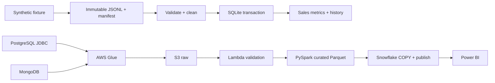

# end-to-end-data-engineering-project

A hands-on e-commerce batch data engineering project: follow synthetic orders and customer profiles from source records to trusted sales metrics, then test what happens when files disappear, a customer changes, or a batch runs twice.

**Status:** the offline Python/SQLite reference is implemented and tested. PostgreSQL/MongoDB setup, AWS Glue/PySpark jobs, Lambda validation, Snowflake publication SQL, an Airflow DAG, and a Step Functions workflow are supplied as a **cloud integration lab**. They have not been deployed or verified against AWS/Snowflake. Recorded voiceover and a Power BI `.pbix` are not included.

## Run the working demo

Requires Python 3.11+; the offline path has no third-party dependencies or cloud costs.

```bash
git clone https://github.com/datainteg/end-to-end-data-engineering-project.git
cd end-to-end-data-engineering-project
python3 -m unittest discover -s tests -v
python3 -m pipeline.local demo
python3 -m pipeline.local customer-change
```

The demo publishes a baseline, immediately replays it, and prints:

```json
{
  "net_sales": "1200.00",
  "paid_orders": 2,
  "aov": "600.00",
  "payment_success_rate": "0.5000"
}
```

Amounts are synthetic INR. `customer-change` creates an observed Silver → Gold customer version while existing sales keep their original customer key. Running `demo` again is safe. Runtime files stay in ignored `.runtime/`; use `--root .runtime/new-demo` to start a separate warehouse.

## What you will learn

- Define order, order-line and payment-attempt grains without multiplying revenue.
- Preserve immutable extraction attempts and validate selected files and counts.
- Apply exact money arithmetic, duplicate checks, quarantine and foreign-key checks.
- Publish facts, observed customer history, batch ledger and watermarks atomically.
- Demonstrate replay, rollback, missing files, soft deletions and serialized publication.
- Map the same ideas to Glue, S3, Snowflake, orchestration and Power BI.



The top path runs locally. The cloud path requires your own accounts, private source connectivity and integration validation. Airflow starts and waits for the Standard Step Functions workflow; Step Functions coordinates the cloud jobs.

## Follow the guides

| Guide | Purpose |
| --- | --- |
| [Local walkthrough](docs/GETTING_STARTED.md) | Commands, expected results, source containers, recovery |
| [Cloud setup](docs/CLOUD_SETUP.md) | Infrastructure, connections, packaging, jobs, SQL and execution |
| [Implementation status](docs/IMPLEMENTATION_STATUS.md) | Verified behavior, design changes and unfinished integration work |
| [Data contracts](docs/DATA_CONTRACTS.md) | Dataset grains, fixture arithmetic and history semantics |
| [Architecture](docs/ARCHITECTURE.md) | Original target architecture and production extensions |
| [Operations](docs/OPERATIONS.md) | Recovery, access boundaries and teardown |
| [Power BI guide](powerbi/README.md) | Model, measures, report layout and reconciliation |
| [Tutorial recording guide](tutorial/README.md) | 30-minute chapter plan and exact recording steps |
| [Voiceover scripts](tutorial/voiceover/README.md) | Nine clean narration files, clip names and pronunciations |
| [Validation evidence](docs/VALIDATION.md) | Local checks actually executed |

## Repository map

```text
pipeline/          dependency-free local reference, fixture and shared validation
sources/           PostgreSQL schema
local/             PostgreSQL + MongoDB Compose configuration
jobs/              Glue extraction, PySpark transform, Snowflake publish wrapper
lambdas/           manifest validation and durable pipeline mutex
sql/snowflake/     storage integration, warehouse DDL, publish DML and validation
orchestration/     Airflow DAG and generated Step Functions example
infra/             CloudFormation S3/DynamoDB/SNS foundation
scripts/           source seeding, packaging, workflow generation and publishing
tests/             correctness and failure-boundary tests
powerbi/           report construction guide and DAX measures
tutorial/          public teaching and voiceover material
```

## Important scope choices

This first implementation uses **small, frozen full snapshots**, capped at 10,000 records per dataset in the cloud code. Watermarks track successful publication, but this release does not implement incremental extraction. The local path uses integer paise; cloud Parquet and Snowflake use decimal money. The cloud path blocks publication whenever quarantine is nonempty.

The cloud publisher runs synchronously in a Glue job. A durable, non-expiring DynamoDB mutex serializes workflow executions; failures retain the mutex for manual reconciliation. Automatic lease takeover, scalable incremental loading, asynchronous SQL polling and BI Service refresh are future work. See the [status matrix](docs/IMPLEMENTATION_STATUS.md) before making production claims.

Credentials, machine configuration, source exports, recordings and private production plans are ignored. Only synthetic fixture data belongs in commits. See [CONTRIBUTING.md](CONTRIBUTING.md) for checks and [LICENSE](LICENSE) for reuse terms.
