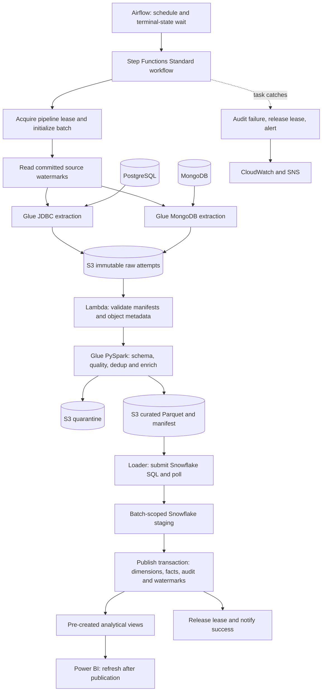

# Architecture

> Original target design. For the current runnable release, verification results and deliberate simplifications, read [IMPLEMENTATION_STATUS.md](IMPLEMENTATION_STATUS.md).

This is the implementation design. Diagrams represent intended behavior, not a deployed system.



## Ownership and execution boundaries

Airflow schedules and starts a Standard state machine, then waits for its terminal state. Step Functions runs parallel extract jobs, validation, transform, load/publish and error handling. Glue performs distributed data work. Lambda performs bounded control work and metadata checks. Snowflake executes warehouse SQL. Data does not flow through the Airflow metadata database or Step Functions payloads: pass manifest URIs and identifiers.

Use Glue `startJobRun.sync` so downstream states wait for the job. AWS documents this integration in [Glue with Step Functions](https://docs.aws.amazon.com/step-functions/latest/dg/connect-glue.html). Use the supported Airflow start operator and terminal-state sensor/deferrable wait after selecting compatible versions; see [Airflow Step Functions integration](https://airflow.apache.org/docs/apache-airflow-providers-amazon/stable/operators/step_functions.html).

The Snowflake execution bridge is a required implementation component, absent from the original sketch. Proposed choice: a small submit/poll Lambda pair using the selected Snowflake client/API, with statement handles persisted by batch and operation. Step Functions waits and polls; it does not keep a Lambda invocation open for long SQL. Verify authentication, packaged dependencies, query cancellation and reattachment before accepting this bridge. A timeout after submission must reconcile existing query state before submitting again.

## Source networking

Docker databases on a laptop are useful for local seeding and logic checks. They are not automatically reachable from Glue. Default cloud-demo proposal: PostgreSQL and MongoDB on a dedicated, temporary development host in the same VPC as Glue; restrict database ingress to the Glue security group, with encrypted connections and controlled administration. Managed PostgreSQL and MongoDB hosting is an alternative if already available.

Configure subnet routing, DNS, security groups, S3 access and access to Secrets Manager. Document internet egress or service endpoints and their costs. Keep the local Docker path clearly separate from the real cloud connectivity proof. Source credentials, region and hosting selection remain implementation inputs. See [Glue JDBC VPC networking](https://docs.aws.amazon.com/glue/latest/dg/connection-JDBC-VPC.html) and [MongoDB connection prerequisites](https://docs.aws.amazon.com/en_en/glue/latest/dg/creating-mongodb-connection.html).

Step Functions coordinates service calls; the state machine itself is not a worker running inside the database VPC. Two orchestrators are retained because the chat selected them; the narration must explain their responsibilities and acknowledge that a smaller pipeline could use one.

## Batch state and commit boundary

Use a small DynamoDB lease table for cross-entry-point serialization (an added design dependency). Acquire conditionally by pipeline key; include owner execution, lease expiry and heartbeat. Abort publication if ownership is lost. Lease expiry alone is not proof that the previous Snowflake query stopped: reconcile/cancel in-flight queries before transferring publication ownership. Airflow also uses one active run.

Snowflake CONTROL tables hold committed source watermarks and the publication ledger. Read these before extraction; update all watermarks in the same DML transaction as dimensions, facts and the successful batch ledger. Pre-create tables/views outside that transaction. If SQL commits but the client times out, look up the batch ledger before retrying. S3 audit files and notifications are follow-up outputs, not the authoritative commit.

State progression: `CREATED → EXTRACTING → VALIDATED → TRANSFORMED → LOADED → PUBLISHED`. A failure before publication preserves watermarks. A failure after publication is a follow-up operations failure; it must not replay the business transaction blindly.

This atomic publication boundary is a project design based on [Snowflake transaction behavior](https://docs.snowflake.com/en/sql-reference/transactions), not a claim of distributed exactly-once execution across AWS, Snowflake and Power BI.

## S3 layout

```text
s3://<project-bucket>/
  raw/source=postgresql/dataset=orders/batch_id=<id>/attempt_id=<id>/part-*.parquet
  raw/source=mongodb/dataset=customers/batch_id=<id>/attempt_id=<id>/part-*.jsonl
  staging/batch_id=<id>/attempt_id=<id>/manifest.json
  curated/dataset=sales/batch_id=<id>/attempt_id=<id>/part-*.parquet
  curated/dataset=sales/batch_id=<id>/attempt_id=<id>/manifest.json
  rejected/dataset=<name>/batch_id=<id>/attempt_id=<id>/part-*.parquet
  audit/batch_id=<id>/quality.json
  audit/batch_id=<id>/execution.json
  scripts/<release-id>/...
```

Raw is the immutable extraction archive. Staging holds control manifests rather than a second indistinguishable raw copy. Curated files are also immutable per attempt; warehouse staging is a separate Snowflake concept. Do not COPY an unbounded prefix containing every previous attempt.
