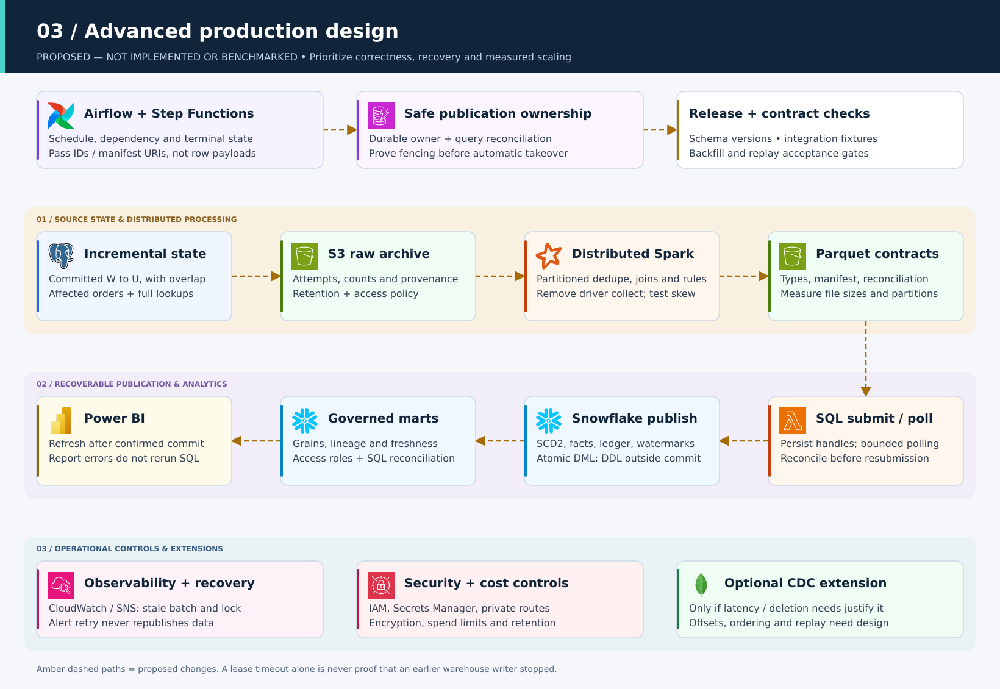
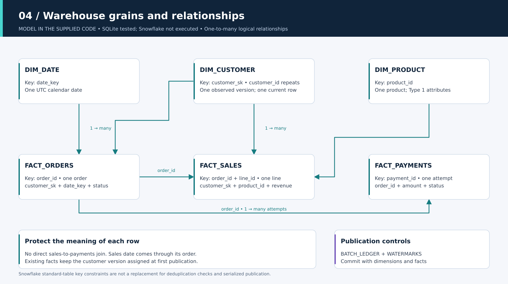
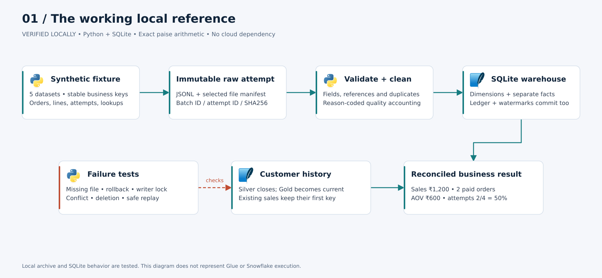

[← Project home](../../README.md) · [All docs](../README.md) · [Architecture](../ARCHITECTURE.md) · [Interview guide](../INTERVIEW_QUESTIONS.md)

# Architecture diagrams

Open the previews below for reading, or download [ecommerce-architecture.drawio](ecommerce-architecture.drawio) for editing. It contains four pages, editable cards, labels, connectors and embedded tool logos. No external image URLs are needed to display the diagrams.

| Page | Meaning | Preview |
| --- | --- | --- |
| 01 — Local reference | Working Python/SQLite implementation | [SVG](local-reference.svg) |
| 02 — Cloud workflow | Supplied integration code; not deployed/verified | [SVG](cloud-workflow.svg) |
| 03 — Advanced design | Proposed scaling and recovery improvements | [SVG](advanced-roadmap.svg) |
| 04 — Warehouse model | Actual grains and logical key relationships | [SVG](warehouse-model.svg) |

## Cloud workflow


Read the data path left to right across the first processing row, then right to left across the second. Teal arrows show data movement; dashed purple arrows show control. The bottom cards describe cross-cutting setup, not extra data-processing stages. The DynamoDB card summarizes the mutex; the actual acquire/release API calls run through the lock Lambda.

## Advanced design



Amber dashed paths identify the proposed design. Top and bottom cards describe controls that apply across the pipeline. Incremental extraction, distributed validation, asynchronous SQL coordination, automatic fenced ownership and CDC are **not** implemented by changing this diagram. See the [upgrade plan](../ARCHITECTURE.md#advanced-upgrade-plan) for the evidence needed before claiming each improvement.

## Warehouse model



Arrows run from the one side to the many side of logical relationships. There is no direct sales-to-payments relationship. Dates attach to order headers; the sales mart reaches the date through the order. Customer surrogate keys represent observed versions, not automatically the version at original order time.

## Local reference



Use this page when demonstrating the commands that run without cloud accounts. The bottom cards highlight tested history and metric behavior.

## Edit in draw.io / diagrams.net

1. Download the `.drawio` file using GitHub's raw download button, or use the checked-out local file.
2. Open diagrams.net or draw.io Desktop. Choose **File → Open From → Device** and select the file.
3. Select a page using the page tabs. Move a card with its child labels/icons, double-click a label to edit it, or reconnect an arrow.
4. Save a `.drawio` copy. Export the relevant page as SVG or PNG for slides and documents. Include diagram data in an export if you want that image to remain editable in draw.io.
5. Keep the status banner: **verified local**, **unverified cloud code**, or **proposed**. Do not erase the distinction when preparing interview slides.

The generated draw.io file uses embedded images and editable native graph cells. SVG previews are generated independently from the same layout specification, rather than screen captures of the draw.io editor. XML structure and previews were checked; an interactive draw.io import has not been run in this workspace.

## Rebuild without an editor

```bash
python3 scripts/build_architecture_diagrams.py
```

The standard-library generator reads vendored icons and creates all four SVGs plus the multi-page `.drawio` file. It performs no network requests. Edit its `specs()` function for changes that should regenerate consistently. Manual draw.io edits are not imported into the generator and will be overwritten by regeneration; keep manual variants separately or update the layout specification too.

SVGs are convenient for GitHub and scale without blurring text. The Snowflake mark is a small raster source embedded in an otherwise vector diagram. Sources, versions and license notices are recorded in [ICON_CREDITS.md](ICON_CREDITS.md).
